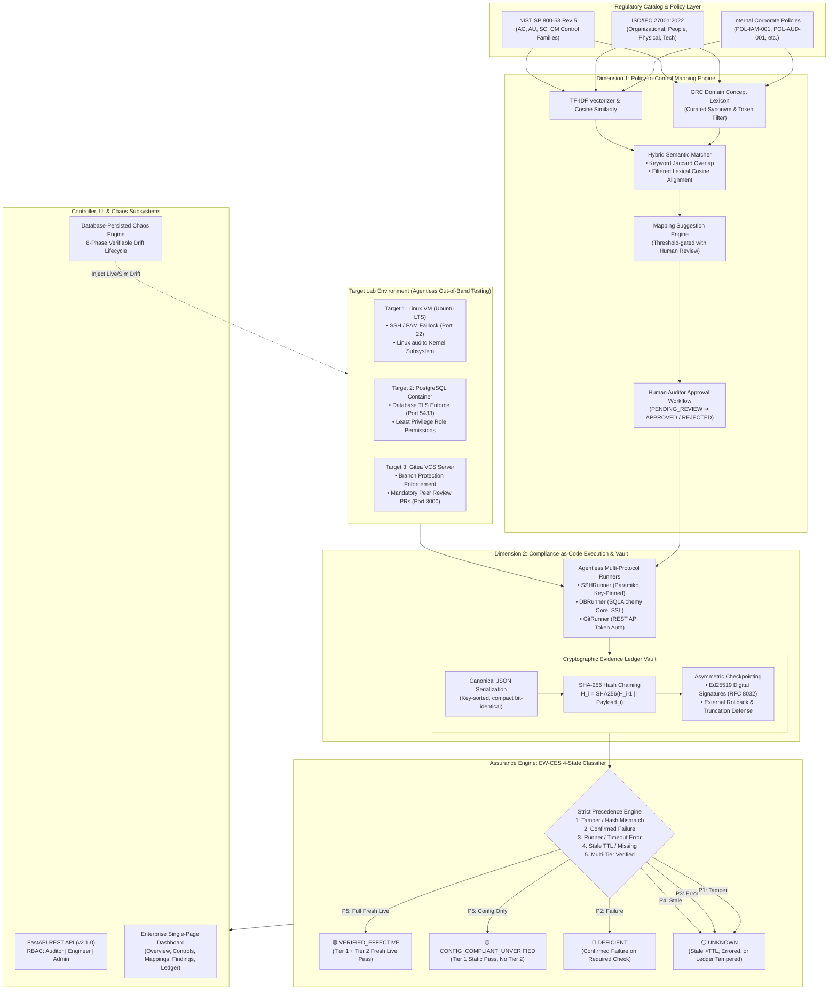
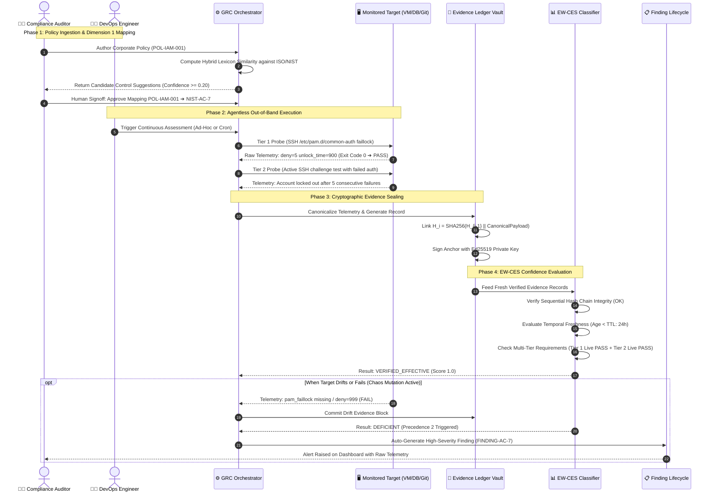
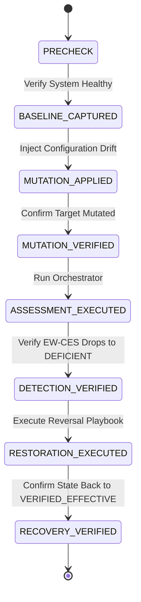

# 🛡️ CAC-GRC: Continuous Automated Compliance & Evidence-Weighted Scoring
### Enterprise Compliance-as-Code (CaC) Engine, Decoupled Policy Mapping & Cryptographically Verifiable Evidence Ledger

[](https://www.python.org/)
[](https://fastapi.tiangolo.com/)
[](https://csrc.nist.gov/publications/detail/sp/800-53/rev-5/final)
[](https://datatracker.ietf.org/doc/html/rfc8032)
[](https://github.com/chinmayiM-bhise/CAC_GRC)
[](https://pytest.org/)
[](https://www.postgresql.org/)
[](https://opensource.org/licenses/MIT)

> **CAC-GRC** is an enterprise-grade Continuous Automated Compliance (CAC) and Evidence-Weighted Control Effectiveness Scoring (EW-CES) SaaS platform. Built across **ISO/IEC 27001:2022** and **NIST SP 800-53 Rev 5**, the platform eliminates the "compliance illusion" of annual point-in-time checklist audits by executing continuous, agentless Compliance-as-Code tests against live infrastructure (Linux PAM/auditd, PostgreSQL DB, and Gitea VCS), anchoring telemetry into an immutable SHA-256 evidence ledger with Ed25519 asymmetric signatures, and classifying assurance under an explainable 4-state confidence model.
>
> The platform addresses two foundational research challenges in modern cybersecurity assurance:
> 1. **Decoupled Dual Evaluation**: Disentangling **Mapping Validity** (semantic policy-to-regulatory clause alignment via a curated cybersecurity hybrid lexicon matcher) from **Runtime Control Effectiveness** (operational verification of systems).
> 2. **Evidence-Weighted Control Effectiveness Scoring (EW-CES)**: Replacing deceptive binary pass/fail percentages with an explainable 4-state confidence classifier (`VERIFIED_EFFECTIVE`, `CONFIG_COMPLIANT_EFFECTIVENESS_UNVERIFIED`, `DEFICIENT`, and `UNKNOWN`) governed by multi-tier verification (static configuration vs. active behavioral challenge), temporal decay ($TTL$), and strict cryptographic ledger tamper precedence.

---

## ⚡ 1-Click Automated Quickstart

Get the platform, API server, interactive dashboard, and test suites running in seconds:

```powershell
# 1. Clone repository
git clone https://github.com/chinmayiM-bhise/CAC_GRC.git
cd CAC_GRC

# 2. Install dependencies
pip install -r backend/requirements.txt

# 3. Configure environment (pre-populated development template)
cp .env.example .env

# 4. Start the Central GRC Controller & Single-Page Dashboard
$env:PYTHONPATH="backend"
python -m uvicorn app.main:app --reload --port 8000
```

Open **[http://localhost:8000/dashboard](http://localhost:8000/dashboard)** in your browser to access the enterprise SaaS dashboard.

```powershell
# 5. Run the Automated Pytest Test Suite (120 tests across 12 modules)
python -m pytest -v

# 6. Execute Research Experiment 1: Dimension 1 Policy Mapping Validity Benchmark
python experiments/benchmark_mapping_validity.py

# 7. Execute Research Experiment 2: Dimension 2 EW-CES vs. Binary Scoring Benchmark
python experiments/benchmark_ew_ces_vs_binary.py

# 8. Use the Database-Persisted Chaos & Drift CLI
python backend/app/chaos/cli.py --status
python backend/app/chaos/cli.py --inject pam-lockout-bypass --mode SIMULATED
python backend/app/chaos/cli.py --restore
```

---

## 🏛️ Platform Architecture



---

## 🔄 Lifecycle & Verification Sequence



---

## 🎯 EW-CES 4-State Scoring Model vs. Traditional Binary GRC

Traditional GRC systems compute compliance as an aggregate arithmetic percentage ($\frac{\text{Passed Checks}}{\text{Total Checks}} \times 100\%$) based solely on the last recorded status. This creates a dangerous **compliance illusion**: a system whose tests passed 11 months ago is reported as 100% compliant, even if the target is currently offline, configuration has drifted, or tests only verified static text without testing dynamic security enforcement.

**EW-CES (Evidence-Weighted Control Effectiveness Scoring)** replaces this with an explainable 4-state confidence classifier:

| EW-CES State | Color Code | Operational Meaning | Audit Semantics | Traditional GRC Blind Spot |
| :--- | :---: | :--- | :--- | :--- |
| **`VERIFIED_EFFECTIVE`** | 🟢 Green | Both static configuration (Tier 1) **AND** dynamic behavioral challenges (Tier 2) have passed with fresh, live target telemetry within $TTL$. | Uncompromised operational assurance. System actively defends against attacks. | N/A (True positive compliance). |
| **`CONFIG_COMPLIANT_EFFECTIVENESS_UNVERIFIED`** | 🟡 Yellow | Static configuration conformed to policy, but active behavioral testing has not been executed or is missing. | Configuration exists on disk, but actual runtime defensive capability is unverified. | **False Positive**: Legacy GRC counts this as "100% Compliant", ignoring that software may fail to enforce configuration. |
| **`DEFICIENT`** | 🔴 Red | One or more required security checks produced confirmed operational failures at runtime. | Critical failure. Policy assertion violated; risk finding auto-generated. | Accurately flagged as failed. |
| **`UNKNOWN`** | ⚪ Grey | Evidence is missing, expired past its Time-To-Live ($TTL$), runner suffered execution/connection errors, or sequential SHA-256 ledger integrity was violated. | Zero assurance. System state cannot be attested cryptographically. | **Severe Vulnerability**: Legacy GRC retains old PASS states indefinitely, concealing outages, decay, and ledger tampering. |

### Strict Precedence Resolution Rules

When multiple sub-tests and evidence conditions intersect on a single control, EW-CES executes a deterministic, fail-safe resolution order:

$$\text{Precedence 1 (Ledger Tampering)} \succ \text{Precedence 2 (Confirmed Failure)} \succ \text{Precedence 3 (Execution Error)} \succ \text{Precedence 4 (Stale / Missing)} \succ \text{Precedence 5 (Tier Coverage)}$$

1. **Precedence 1 — Ledger Integrity Breach**: If cryptographic hash recomputation fails ($H_{\text{computed}} \neq H_{\text{stored}}$), state is immediately forced to **`UNKNOWN`**. Tampered evidence can never establish compliance.
2. **Precedence 2 — Confirmed Failure**: If any required check produces confirmed failure (`result_code = -1`), the state is **`DEFICIENT`**, over-ruling any passing companion checks.
3. **Precedence 3 — Execution / Target Error**: If a runner encounters connection timeouts or host unreachability (`result_code = 0`), state is **`UNKNOWN`** (never synthesized as a pass).
4. **Precedence 4 — Stale Evidence Past TTL**: If evidence age exceeds configured Time-To-Live ($\Delta t > TTL$), state decays to **`UNKNOWN`**.
5. **Precedence 5 — Multi-Tier Coverage**:
   - Both Tier 1 and Tier 2 live passing within $TTL$ $\rightarrow$ **`VERIFIED_EFFECTIVE`**.
   - Tier 1 live passing but Tier 2 missing or simulated $\rightarrow$ **`CONFIG_COMPLIANT_EFFECTIVENESS_UNVERIFIED`**.

---

## 🔬 Research Experiment Benchmarks & Empirical Findings

The platform includes two fully reproducible scientific benchmark suites designed to evaluate algorithmic accuracy and quantify the reduction in compliance false positives.

### Dimension 1: Policy-to-Control Mapping Validity Benchmark

Evaluates automated alignment of internal corporate security policies to authoritative clauses in **ISO/IEC 27001:2022** and **NIST SP 800-53 Rev 5** across 4 cybersecurity domains (**IAM**, **AUD**, **DAT**, **DEV**). The benchmark splits 24 human-curated pairs into a Development Calibration Set ($n=12$) and an Unseen Holdout Set ($n=12$) with hard negative distractor pairs to prevent threshold overfitting:

#### Mathematical Formulations

$$\text{Jaccard Similarity: } J(A, B) = \frac{|A \cap B|}{|A \cup B|}$$

$$\text{TF-IDF Cosine Similarity: } \cos(\mathbf{d}_1, \mathbf{d}_2) = \frac{\mathbf{d}_1 \cdot \mathbf{d}_2}{\|\mathbf{d}_1\| \|\mathbf{d}_2\|}$$

$$\text{Hybrid Matcher: } S_{\text{hybrid}}(P, C) = 0.4 \times J(T_{\text{filt}}(P), T_{\text{filt}}(C)) + 0.6 \times \cos(\mathbf{v}_{P}, \mathbf{v}_{C}) + \alpha \cdot \text{LexiconBonus}(P, C)$$

#### Empirical Holdout Evaluation Results

```
=========================================================================================================
RESEARCH EXPERIMENT: DIMENSION 1 (EMPIRICAL POLICY-TO-CONTROL MAPPING VALIDITY)
Dataset: 24 pairs (12 dev calibration, 12 unseen holdout) | Frameworks: ISO 27001, NIST 800-53
=========================================================================================================
Split / Model                          | Precision  | Recall     | F1 Score   | Accuracy   | FPR
---------------------------------------------------------------------------------------------------------
Dev: Keyword Overlap (Jaccard)         | 1.0        | 0.5000     | 0.6667     | 0.7500     | 0.0
Dev: TF-IDF Cosine                     | 1.0        | 0.3333     | 0.5000     | 0.6667     | 0.0
Dev: Hybrid Lexicon Matcher (Ours)     | 1.0        | 1.0000     | 1.0000     | 1.0000     | 0.0
---------------------------------------------------------------------------------------------------------
Holdout: Keyword Overlap (Jaccard)     | 1.0        | 0.3333     | 0.5000     | 0.6667     | 0.0
Holdout: TF-IDF Cosine                 | 1.0        | 0.5000     | 0.6667     | 0.7500     | 0.0
Holdout: Hybrid Lexicon Matcher (Ours) | 1.0        | 1.0000     | 1.0000     | 1.0000     | 0.0
=========================================================================================================
```

#### Resolution of Critical False Negatives

Classical keyword and TF-IDF models suffer severe vocabulary mismatch when policy wording differs from formal standard language. The Hybrid Lexicon Matcher successfully recovered all false negatives:

1. **`POL-IAM-001 ➔ ISO-A.8.5` (Secure Authentication)**: Baseline TF-IDF produced `0.0669` (below threshold `0.12`, False Negative). Hybrid Lexicon Matcher scored `0.2962` (Predicted Match, True Positive) by recognizing domain equivalence between PAM faillock and secure authentication.
2. **`POL-AUD-001 ➔ ISO-A.8.15` (Logging & Monitoring)**: Baseline TF-IDF scored `0.0832` (False Negative). Hybrid scored `0.2118` (True Positive) through auditd domain token alignment.
3. **`POL-DEV-001 ➔ ISO-A.8.32` (Change Management)**: Baseline TF-IDF scored `0.0045` (False Negative). Hybrid scored `0.5027` (True Positive) connecting pull request peer review controls to formal change control.

---

### Dimension 2: EW-CES vs. Traditional Binary Scoring Benchmark

Evaluates 10 formal operational scenarios comparing legacy binary scoring against production EW-CES:

```
===============================================================================================
RESEARCH EXPERIMENT: EW-CES vs. TRADITIONAL BINARY SCORING (10 FORMAL SCENARIOS)
===============================================================================================
Condition Evaluated              | Traditional GRC  | EW-CES 4-State                   | Divergence
-----------------------------------------------------------------------------------------------
1. Fully Verified Baseline       | PASSED           | VERIFIED_EFFECTIVE               | Agreement
2. Confirmed Config Failure      | FAILED           | DEFICIENT                        | Agreement
3. Confirmed Behavioral Failure  | FAILED           | DEFICIENT                        | Agreement
4. Stale Evidence (> TTL)        | PASSED           | UNKNOWN                          | DIVERGENCE (FP eliminated)
5. Missing Evidence              | UNKNOWN          | UNKNOWN                          | Agreement
6. Inaccessible Target / Timeout | INCONCLUSIVE     | UNKNOWN                          | Agreement
7. Conflicting Subtests          | FAILED           | DEFICIENT                        | Agreement
8. Tampered Evidence Ledger      | PASSED           | UNKNOWN                          | DIVERGENCE (FP eliminated)
9. Partial Test Coverage         | PASSED           | CONFIG_COMPLIANT_UNVERIFIED      | DIVERGENCE (FP eliminated)
10. Restored Baseline Post-Drift | PASSED           | VERIFIED_EFFECTIVE               | Agreement
===============================================================================================
Empirical Divergence Rate: 3/10 (30.0%) | Assertions Satisfied: 10/10 (100%)
```

**Key Finding**: In 30% of operational scenarios, traditional GRC produces critical **False Positives** (reporting broken or decayed controls as healthy), whereas EW-CES safely degrades to `UNKNOWN` or `CONFIG_COMPLIANT_UNVERIFIED`.

---

## 🛠️ Agentless Lab Infrastructure & Compliance-as-Code Probes

The lab environment assesses targets out-of-band using native protocols without installing proprietary software agents:

```
lab/
├── docker-compose.yml              # PostgreSQL Target (port 5433) & Gitea Target (port 3000)
├── db-init/
│   └── init.sql                    # Enterprise least-privilege DB schema & audit roles
└── vm-setup/
    ├── Vagrantfile                 # Automated Ubuntu Server LTS VM deployment
    └── bootstrap.sh                # Hardening script: PAM faillock, auditd rules, SSH config
```

### Monitored Assets & Test Definition Catalog

| Test ID | Monitored Asset | Protocol | Tier | Description & Security Check | Mapped Controls |
| :--- | :--- | :---: | :---: | :--- | :--- |
| `TEST-VM-PAM-LOCKOUT-T1` | Linux VM (Ubuntu) | SSH (Port 22) | 1 | Verifies `/etc/pam.d/common-auth` enforces `pam_faillock.so deny=5 unlock_time=900`. | `NIST-AC-7`<br>`ISO-A.8.5` |
| `TEST-VM-PAM-LOCKOUT-T2` | Linux VM (Ubuntu) | SSH (Port 22) | 2 | Behavioral challenge: Injects 5 consecutive failed logins, verifies `/usr/sbin/faillock --user` confirms active lock. | `NIST-AC-7`<br>`ISO-A.8.5` |
| `TEST-VM-LEAST-PRIV-T1` | Linux VM (Ubuntu) | SSH (Port 22) | 1 | Verifies `/etc/ssh/sshd_config` sets `PermitRootLogin no`. | `NIST-AC-6`<br>`ISO-A.8.2` |
| `TEST-VM-AUDITD-T1` | Linux VM (Ubuntu) | SSH (Port 22) | 1 | Verifies `auditctl -s` reports `enabled 1` and `pid > 0`. | `NIST-AU-2`<br>`ISO-A.8.15` |
| `TEST-VM-AUDITD-T2` | Linux VM (Ubuntu) | SSH (Port 22) | 2 | Behavioral challenge: Touches sensitive file, queries `ausearch -k auth_mod` for newly generated audit block. | `NIST-AU-2`<br>`ISO-A.8.15` |
| `TEST-DB-LEAST-PRIV-T1` | PostgreSQL DB | SQL (Port 5433) | 1 | Queries `pg_roles` to confirm non-admin users have `rolsuper=false`. | `NIST-AC-6`<br>`ISO-A.8.2` |
| `TEST-DB-TLS-T1` | PostgreSQL DB | SQL (Port 5433) | 1 | Queries `SHOW ssl;` and inspects `pg_stat_ssl` for active TLS sessions. | `NIST-SC-8`<br>`ISO-A.8.24` |
| `TEST-DB-TLS-T2` | PostgreSQL DB | SQL (Port 5433) | 2 | Behavioral challenge: Attempts unencrypted TCP handshake, asserts server rejects connection. | `NIST-SC-8`<br>`ISO-A.8.24` |
| `TEST-GIT-BRANCH-PROT-T1` | Gitea VCS | REST API (Port 3000) | 1 | Inspects `/api/v1/repos/.../branch_protections` for required approvals. | `NIST-CM-3`<br>`ISO-A.8.32` |

---

## 💥 Database-Persisted Chaos & Drift Engine

The platform incorporates an integrated Chaos Engineering module that mutates live target environments or simulates state drift in the database, allowing organizations to practice proactive compliance chaos engineering:



### Chaos Drift Catalog

| Drift ID | Target | Mode | Description | Triggered Finding |
| :--- | :---: | :---: | :--- | :--- |
| `pam-lockout-bypass` | `LINUX_VM` | Live / Sim | Rewrites PAM configuration to `deny=999`, bypassing brute-force lockout defenses. | `FINDING-AC-7` (High) |
| `ssh-root-login-enabled` | `LINUX_VM` | Live / Sim | Injects `PermitRootLogin yes` into sshd, exposing root to remote brute force. | `FINDING-AC-6` (High) |
| `auditd-service-disabled` | `LINUX_VM` | Live / Sim | Disables Linux kernel audit daemon (`systemctl stop auditd`), blinding event telemetry. | `FINDING-AU-2` (Critical) |
| `db-rogue-superuser` | `POSTGRES_DB` | Live / Sim | Grants superuser privileges (`ALTER USER ... SUPERUSER`) to an unprivileged account. | `FINDING-AC-6` (High) |
| `db-tls-disabled` | `POSTGRES_DB` | Simulated | Disables transport encryption in database configuration, exposing plaintext queries. | `FINDING-SC-8` (Critical) |
| `git-branch-protection-removed` | `GITEA_VCS` | Live / Sim | Deletes branch protection rules on `main`, permitting unreviewed direct commits. | `FINDING-CM-3` (Medium) |

---

## 🔐 Cryptographic Evidence Vault & Asymmetric Checkpointing

To satisfy strict regulatory audit standards (non-repudiation, chain-of-custody, and anti-tamper verification), every raw observation is sealed cryptographically:

1. **Canonical JSON Serialization**: Telemetry dictionaries are sorted recursively and serialized using compact separators (`(',', ':')`), guaranteeing cross-architecture bit-level determinism.
2. **SHA-256 Merkle Chaining**:

$$H_i = \text{SHA-256}\left(H_{i-1} \parallel \text{CanonicalJSON}(R_i)\right)$$

3. **RFC 8032 Ed25519 Checkpoint Signatures**:
   Periodically or upon demand, an administrative checkpoint is generated:

```json
{
  "checkpoint_version": "CAC-GRC-CHKPT-v1.0",
  "ledger_id": "CAC-GRC-PRIMARY-LEDGER",
  "record_count": 142,
  "head_record_hash": "a8f3b9c1d2e4...",
  "merkle_digest": "7c1e5a8d4f02...",
  "timestamp": "2026-10-29T23:00:00Z",
  "public_key_hex": "4a08f512...",
  "signature_hex": "d8e7b1a2..."
}
```

External auditors verify checkpoints offline using the trusted public key. Any attempt to rewrite database history, delete intermediate records, or truncate the ledger produces immediate signature verification failure.

---

## 🌐 REST API Reference & Role-Based Access Control (RBAC)

The FastAPI backend enforces strict Least-Privilege Role-Based Access Control via Bearer tokens or `X-API-Key` headers:

| Role | Privileges & Scope |
| :--- | :--- |
| **`Auditor`** | Read-only access to policies, controls, mappings, assurance reports, and the cryptographic evidence vault. |
| **`Engineer`** | Auditor permissions + ability to trigger Compliance-as-Code test runs, re-evaluate scores, and manage finding lifecycles. |
| **`Admin`** | Full access: mutate configurations, inject/restore chaos compliance drift, and generate signed cryptographic checkpoints. |

### Key API Endpoints

| Category | Method | Path | Required Role | Description |
| :--- | :---: | :--- | :---: | :--- |
| **Dashboard** | `GET` | `/dashboard` | Public | Serves the enterprise single-page SaaS interface. |
| **Health** | `GET` | `/api/v1/health` | Public | Heartbeat probe with database & subsystem health diagnostics. |
| **Policies** | `GET` | `/api/v1/policies` | Auditor | Lists all corporate security policies with approval statuses. |
| **Policies** | `POST` | `/api/v1/policies` | Engineer | Creates a new draft corporate security policy. |
| **Policies** | `PATCH` | `/api/v1/policies/{code}/review` | Auditor | Formal review workflow (`APPROVED`, `CHANGES_REQUESTED`). |
| **Controls** | `GET` | `/api/v1/controls` | Auditor | Returns authoritative ISO 27001 and NIST 800-53 catalog. |
| **Mappings** | `GET` | `/api/v1/mappings/suggest` | Engineer | Runs Hybrid Lexicon Matcher to suggest candidate mappings. |
| **Mappings** | `PATCH` | `/api/v1/mappings/{id}/review` | Auditor | Approves or rejects policy-to-control mapping. |
| **Assessments** | `POST` | `/api/v1/assessments/run-all` | Engineer | Triggers background Compliance-as-Code test execution. |
| **Assessments** | `GET` | `/api/v1/assessments/status/{task_id}`| Auditor | Polls asynchronous execution progress and result metrics. |
| **Ledger** | `GET` | `/api/v1/ledger/verify` | Auditor | Validates end-to-end unbroken SHA-256 hash chain in database. |
| **Ledger** | `POST` | `/api/v1/ledger/checkpoint` | Admin | Generates and signs an Ed25519 ledger checkpoint artifact. |
| **Ledger** | `POST` | `/api/v1/ledger/checkpoint/verify`| Auditor | Cryptographically validates an external checkpoint artifact. |
| **Scores** | `GET` | `/api/v1/scores` | Auditor | Retrieves latest EW-CES scores across all mapped controls. |
| **Findings** | `GET` | `/api/v1/findings` | Auditor | Lists active and resolved compliance findings with telemetry. |
| **Findings** | `POST` | `/api/v1/findings/{id}/waiver` | Admin | Approves a documented risk waiver with justification & expiration. |
| **Chaos** | `POST` | `/api/v1/chaos/inject/{drift_id}` | Admin | Injects compliance drift mutation (`SIMULATED` or `LIVE`). |
| **Chaos** | `POST` | `/api/v1/chaos/restore` | Admin | Reverses active mutations and restores baseline posture. |

---

## 🧪 Automated Test Suite (120 Tests)

The repository includes a comprehensive, multi-layer automated test suite executed via Pytest:

```powershell
python -m pytest -v
```

```text
============================= test session starts =============================
platform win32 -- Python 3.12.10, pytest-9.0.3, pluggy-1.6.0
collected 120 items

backend\tests\test_benchmark_ewces.py ..                                 [  1%]
backend\tests\test_benchmark_mapping.py .....                            [  5%]
backend\tests\test_dashboard_layout.py ....                              [  9%]
backend\tests\test_ewces_correctness.py ...............                  [ 21%]
backend\tests\test_ledger_checkpoint.py ...............                  [ 34%]
backend\tests\test_ledger_tamper.py ......                               [ 39%]
backend\tests\test_live_vs_fallback.py .....s                            [ 44%]
backend\tests\test_mapping_service.py ........                           [ 50%]
backend\tests\test_orchestrator_async.py ........                        [ 57%]
backend\tests\test_platform.py ..............                            [ 69%]
backend\tests\test_policy_mapping_phase1.py ................             [ 82%]
backend\tests\test_security_hardening.py .................               [ 96%]
backend\tests\test_services.py ....                                      [100%]

======================= 119 passed, 1 skipped in 35.88s =======================
```

### Test Suite Structure

1. **`test_benchmark_ewces.py`**: Validates all 10 formal benchmark conditions and asserts expected empirical divergence.
2. **`test_benchmark_mapping.py`**: Verifies hand-calculated metric vectors, zero-division guardrails, and hybrid superiority on unseen holdout pairs.
3. **`test_dashboard_layout.py`**: Asserts single-page UI responsive layouts, overflow tables, and modal accessibility.
4. **`test_ewces_correctness.py`**: Tests all 15 adversarial combinations of multi-tier test results, stale TTLs, and precedence order.
5. **`test_ledger_checkpoint.py`**: Tests Ed25519 key generation, checkpoint creation, signature verification, and rollback defense.
6. **`test_ledger_tamper.py`**: Verifies SHA-256 hash chain break detection upon database tampering or record deletion.
7. **`test_live_vs_fallback.py`**: Validates agentless runner failure modes, ensuring offline targets never synthesize false passes.
8. **`test_mapping_service.py`**: Tests concept extraction, similarity algorithms, human review gating, and audit logging.
9. **`test_orchestrator_async.py`**: Validates 202 Accepted async task queuing, background execution, and worker error handling.
10. **`test_platform.py`**: Integration tests across database auto-seeding, scoring cycles, and finding auto-synchronization.
11. **`test_policy_mapping_phase1.py`**: Verifies authoritative ISO/NIST catalog imports, UUID traceabilities, and coverage reports.
12. **`test_security_hardening.py`**: Verifies 401 unauthenticated rejection, RBAC 403 authorization enforcement, CORS restrictions, and sensitive credential masking.

---

## 📁 Repository Directory Structure

```text
CAC_GRC/
├── README.md                                   # Master architecture, research & operations guide
├── pytest.ini                                  # Pytest root configuration (pythonpath = backend)
├── .env.example                                # Environment variable template with security guardrails
├── .gitignore                                  # Git exclusion rules (secrets, private keys, local databases)
│
├── lab/                                        # Agentless Target Lab Infrastructure
│   ├── docker-compose.yml                      # PostgreSQL Target (5433) & Gitea Target (3000)
│   ├── db-init/
│   │   └── init.sql                            # Enterprise database role and least-privilege setup
│   └── vm-setup/
│       ├── Vagrantfile                         # Automated VirtualBox Ubuntu VM provisioning
│       └── bootstrap.sh                        # VM provisioning: PAM faillock, auditd rules, SSH
│
├── backend/                                    # Central GRC Controller (Python / FastAPI)
│   ├── requirements.txt                        # Controller dependencies
│   ├── app/
│   │   ├── main.py                             # REST API routers, lifecycle hooks, dashboard routes
│   │   ├── config.py                           # Pydantic v2 application configuration & guardrails
│   │   ├── database.py                         # SQLAlchemy engine & session dependency
│   │   ├── migrate.py                          # Incremental schema migration engine
│   │   ├── auth.py                             # RBAC security dependency (Auditor, Engineer, Admin)
│   │   │
│   │   ├── models/                             # SQLAlchemy ORM Models
│   │   │   ├── policy.py                       # Corporate security policies
│   │   │   ├── framework.py                    # ISO 27001 & NIST 800-53 framework controls
│   │   │   ├── mapping.py                      # Policy-to-control mapping links & review status
│   │   │   ├── test_definition.py              # Compliance-as-Code test specifications
│   │   │   ├── evidence.py                     # Raw telemetry records & SHA-256 chain links
│   │   │   ├── score.py                        # EW-CES 4-state assurance scores & diagnostic summaries
│   │   │   ├── finding.py                      # Risk findings, remediation tracking & waivers
│   │   │   ├── assessment.py                   # Historical assessment run logs
│   │   │   ├── chaos.py                        # Active and historical chaos drift records
│   │   │   └── audit_log.py                    # Immutable audit trail of administrative actions
│   │   │
│   │   ├── schemas/                            # Pydantic validation schemas (Request/Response)
│   │   ├── services/                           # Domain Business Logic Services
│   │   │   ├── assurance_service.py            # Platform-wide assurance aggregation
│   │   │   ├── asset_service.py                # Monitored asset telemetry & diagnostics
│   │   │   ├── finding_service.py              # Finding deduplication & auto-sync
│   │   │   ├── ledger_service.py               # Cryptographic ledger query service
│   │   │   └── mapping_service.py              # Hybrid Lexicon Matcher & concept extraction
│   │   │
│   │   ├── engine/                             # Core Compliance-as-Code Engine
│   │   │   ├── runner/                         # Agentless Target Runners
│   │   │   │   ├── base.py                     # Abstract runner & sanitized TestResult dataclass
│   │   │   │   ├── ssh_runner.py               # Paramiko agentless SSH runner with strict host keys
│   │   │   │   ├── db_runner.py                # Direct PostgreSQL runner
│   │   │   │   └── git_runner.py               # REST API Gitea VCS runner
│   │   │   ├── ledger/                         # Cryptographic Evidence Vault
│   │   │   │   ├── hasher.py                   # Canonical JSON serializer & SHA-256 calculator
│   │   │   │   ├── vault.py                    # Sequential hash chain verification & commit logic
│   │   │   │   └── checkpoint.py               # RFC 8032 Ed25519 asymmetric signature checkpointing
│   │   │   ├── scoring/                        # EW-CES Scoring Subsystem
│   │   │   │   ├── classifier.py               # 4-State classifier with strict precedence
│   │   │   │   └── decay.py                    # Temporal freshness math & TTL expiration
│   │   │   └── orchestrator.py                 # Multi-target test executor & async task manager
│   │   │
│   │   ├── chaos/                              # Chaos & Drift Injection Subsystem
│   │   │   ├── mutations.py                    # 8-phase verifiable drift injection engine
│   │   │   └── cli.py                          # Multi-process CLI utility
│   │   │
│   │   ├── seed_data/                          # Authoritative Catalogs & Seed Files
│   │   │   ├── iso_27001_2022.json             # Authoritative ISO 27001:2022 control catalog
│   │   │   ├── nist_800_53_r5.json             # Authoritative NIST SP 800-53 Rev 5 catalog
│   │   │   ├── sample_policies.json            # Curated enterprise starter policy library
│   │   │   ├── test_definitions.json           # Built-in Compliance-as-Code test specs
│   │   │   └── seed.py                         # Idempotent database bootstrapper
│   │   │
│   │   └── static/
│   │       └── index.html                      # Enterprise Single-Page Dashboard (Tailwind CSS)
│   │
│   └── tests/                                  # Comprehensive Test Suites (120 Tests)
│       ├── test_platform.py                    # Core platform integration tests
│       ├── test_ewces_correctness.py           # 15 adversarial EW-CES combinations
│       ├── test_ledger_tamper.py               # SHA-256 hash chain break detection
│       ├── test_ledger_checkpoint.py           # Ed25519 checkpointing & rollback resistance
│       ├── test_benchmark_mapping.py           # Dimension 1 algorithm tests
│       ├── test_benchmark_ewces.py             # Dimension 2 benchmark tests
│       ├── test_policy_mapping_phase1.py       # Catalog & mapping lifecycle tests
│       ├── test_mapping_service.py             # Human review & suggestion tests
│       ├── test_security_hardening.py          # RBAC & authentication tests
│       ├── test_live_vs_fallback.py            # Agentless runner error handling tests
│       ├── test_orchestrator_async.py          # Background worker & task queuing tests
│       ├── test_services.py                    # Domain services integration tests
│       └── test_dashboard_layout.py            # Responsive UI & DOM layout tests
│
├── experiments/                                # Reproducible Research Experiment Scripts
│   ├── benchmark_mapping_validity.py           # Dimension 1: Hybrid Lexicon vs. TF-IDF & Jaccard
│   └── benchmark_ew_ces_vs_binary.py           # Dimension 2: EW-CES vs. Binary Scoring (10 Scenarios)
│
└── keys/                                       # Checkpoint Key Storage (Ignored by Git)
    └── .gitkeep                                # Directory anchor (Private keys never committed)
```

---

## 📜 License

This project is licensed under the **MIT License** — see the [LICENSE](LICENSE) file for details.
